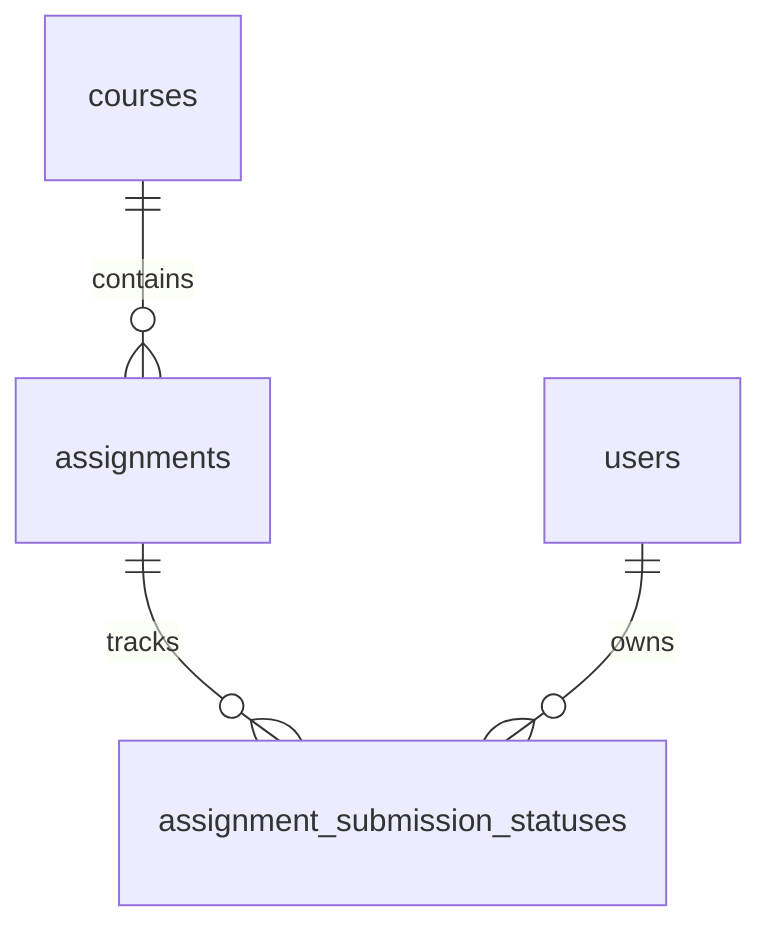

# SIM Platform – Assignments Database Design

Module: Assignments Management  
Status: Schema Approved — Implementation Clarifications Pending  
Backend: Laravel  
Database: MySQL (InnoDB)

## 1. Scope and ownership

Assignments owns `assignments` and `assignment_submission_statuses`. Actual submission occurs outside the platform. The module stores personal tracking statuses, not uploaded solutions or verified grades. Courses owns `courses`; Identity & Access owns `users`; Schedule Builder supplies confirmed course selections. Notifications and Audit Log own their respective records.

## 2. Database standards

- InnoDB, utf8mb4, utf8mb4_unicode_ci.
- Plural snake_case table names and snake_case columns.
- BIGINT UNSIGNED AUTO_INCREMENT primary keys and matching foreign key types.
- DATETIME values stored in UTC and displayed in Africa/Cairo.
- NOT NULL unless absence has a defined meaning.
- ON UPDATE RESTRICT for every foreign key.
- Laravel migrations and backend validation alongside database constraints.

## 3. Table: `assignments`

| Column | Type | Nullability | Constraints / purpose |
|---|---|---|---|
| id | BIGINT UNSIGNED | NOT NULL | PK, AUTO_INCREMENT |
| course_id | BIGINT UNSIGNED | NOT NULL | FK to courses.id |
| title | VARCHAR(255) | NOT NULL | Assignment title |
| submission_requirements | TEXT | NOT NULL | What the student must submit |
| max_marks | SMALLINT UNSIGNED | NULL | Maximum marks; NULL means unknown; zero permitted |
| location | VARCHAR(255) | NOT NULL | Submission location or electronic submission destination |
| deadline | DATETIME | NOT NULL | Date and time of deadline |
| created_at | DATETIME | NOT NULL | Creation time |
| updated_at | DATETIME | NOT NULL | Last update time |

No description, instructions, attachment, publication date, or semester_id column. Multiple assignments may belong to one course. A deadline may be in the past. Maximum marks are not a student's earned grade.

### Indexes

| Index | Columns | Purpose |
|---|---|---|
| PRIMARY KEY | id | Record identity |
| INDEX | course_id, deadline | Course retrieval and deadline ordering; supports course FK |
| INDEX | deadline | Global deadline ordering and expiration queries |
| INDEX | max_marks | Global marks ordering |

## 4. Table: `assignment_submission_statuses`

| Column | Type | Nullability | Constraints / purpose |
|---|---|---|---|
| id | BIGINT UNSIGNED | NOT NULL | PK, AUTO_INCREMENT |
| assignment_id | BIGINT UNSIGNED | NOT NULL | FK to assignments.id |
| user_id | BIGINT UNSIGNED | NOT NULL | FK to users.id |
| status | ENUM('not_submitted','submitted','missed') | NOT NULL | DEFAULT 'not_submitted' |
| submitted_at | DATETIME | NULL | Time of confirmation inside the platform |
| created_at | DATETIME | NOT NULL | Creation time |
| updated_at | DATETIME | NOT NULL | Last update time |

The confirmation timestamp does not prove actual submission or its timing. Only current status is retained. Clear submitted_at when confirmation is reverted or status becomes missed.

### Constraints

```sql
UNIQUE (assignment_id, user_id)
CHECK (
    (status = 'submitted' AND submitted_at IS NOT NULL)
    OR
    (status IN ('not_submitted', 'missed') AND submitted_at IS NULL)
)
```

Use a MySQL version that enforces CHECK constraints. Laravel must also enforce authorization and valid transitions. The database FK alone does not establish student eligibility.

### Indexes

| Index | Columns | Purpose |
|---|---|---|
| PRIMARY KEY | id | Record identity |
| UNIQUE | assignment_id, user_id | One record per student per assignment; supports assignment FK |
| INDEX | user_id | Student tracking and account cleanup |
| INDEX | assignment_id, status | Assignment monitoring by status |

No redundant standalone course_id or assignment_id indexes are required.

## 5. Relationships and referential integrity

| Parent | Child foreign key | Cardinality | ON DELETE | ON UPDATE |
|---|---|---|---|---|
| courses | assignments.course_id | 1 to 0..N | RESTRICT | RESTRICT |
| assignments | assignment_submission_statuses.assignment_id | 1 to 0..N | CASCADE | RESTRICT |
| users | assignment_submission_statuses.user_id | 1 to 0..N | RESTRICT | RESTRICT |



## 6. Status lifecycle

| Event | Result |
|---|---|
| Initial eligible tracking state | not_submitted (subject to expiration) |
| Student confirms before deadline | submitted; set submitted_at |
| Student reverts before deadline | not_submitted; clear submitted_at |
| Deadline reached without confirmation | missed; submitted_at NULL |
| Student attempts confirmation or reversal after deadline | Reject |
| Deadline extended | Restore missed to not_submitted; retain submitted records |
| Deadline shortened to a time already passed | Set not_submitted and previously submitted records to missed; clear submitted_at |

The deadline-extension rule above preserves the approved PRD. Its interaction with an extension that still leaves the deadline expired requires clarification. No late confirmation is allowed under the approved PRD. Admins cannot directly modify student statuses.

## 7. Expiration processing

Laravel Scheduler runs every minute to convert existing not_submitted records whose assignment deadline has expired to missed. Backend reads and mutation requests must also check the deadline directly rather than relying on scheduler timing. The job must not overwrite submitted records. Deadline changes must apply the approved transitions consistently with timestamp constraints.

Implementation recommendation (not a separate approved decision): use conditional updates and transactions or locking to prevent races between the scheduler, student confirmation, and deadline edits. Recheck the current deadline inside the mutation transaction. Process large updates in bounded batches where appropriate.

## 8. Retrieval and sorting

- Students access only assignments belonging to their confirmed course selections; enforce this on every API request.
- Default presentation groups assignments by course and orders by nearest deadline.
- Support global sorting across accessible assignments by deadline or max_marks, ascending or descending.
- Unknown marks appear last in either direction.
- A possible SQL ordering expression is `ORDER BY max_marks IS NULL, max_marks DESC` (or ASC). This expression may require a sort despite the max_marks index; verify with EXPLAIN before further optimization.
- Expired assignments remain visible; deleted assignments do not.
- Admin monitoring exposes student name, student ID and current status, without editing privileges.

## 9. Data lifecycle and transactions

- Hard delete an assignment; its tracking records cascade. Preserve administrative audit records.
- Account deletion: Assignments explicitly deletes its user-owned tracking records within the coordinated account-deletion transaction before deleting the user.
- Removing a course from a confirmed schedule revokes access but retains tracking records; re-adding restores access to previous statuses.
- Administrative course correction retains tracking records, changes visibility, records an audit entry and does not notify students.
- Term reset removes assignment and tracking data; audit retention follows the Audit Log policy.
- Deadline edits must update affected tracking records consistently with the assignment change. Transaction and concurrency implementation details remain to be finalized.

## 10. Module integration

- Schedule Builder: source of truth for student course access.
- Courses: course identifiers and information.
- Identity & Access: users, roles and coordinated account deletion.
- Notifications: assignment creation, updates, deadline changes and deletion; no notification for course correction.
- Audit Log: administrative create, update and delete with actor, entity, time and previous/new values; survives assignment deletion.

## 11. Open implementation decisions

1. Eager versus lazy creation of student tracking records. This was explicitly left open in the PRD. If records are lazy, absent records must still display the correct not_submitted or missed state; the scheduler alone cannot update nonexistent rows. If eager, define initialization for new assignments and newly eligible students.
2. Clarify extension to a deadline that is still expired: the existing extension and expiration rules can conflict.
3. Define presentation of global sorting alongside the grouped-by-course default.
4. Finalize concurrency controls, batch sizes, notification dispatch and audit retention with the relevant modules.

These points are not silently resolved by this schema. No additional tables or fields have been approved.

## 12. Verification checklist

- Duplicate assignment/user pairs rejected.
- Invalid status/timestamp combinations rejected.
- Unknown marks accepted; negative marks rejected.
- Required location and submission requirements enforced.
- Student confirmation and reversal rejected after expiration.
- Scheduler and direct reads handle expired unconfirmed assignments.
- Deadline changes follow the approved PRD transitions.
- Assignment deletion cascades; course/user deletion respects RESTRICT.
- Course removal and re-addition preserve tracking records.
- Global sorting works in both directions with unknown marks last.
- Authorization, notification and audit behavior match the PRD.
