# SIM Platform — Unified Entity Relationship Diagram

Status: Logical ERD baseline; migration and requirements reconciliation pending.

## Scope
31 business tables, 8 business modules. No additional Admin Dashboard or Redis session tables. The diagram shows key columns and physical relationships, not every non-key attribute. Existing module database designs remain the column-level reference. PRDs are unchanged.

## Ownership

### Identity & Access
`academic_levels`, `groups`, `users`, `otp_verifications`, `ban_records`

### Courses
`courses`, `lectures`, `sections`, `educational_files`, `ai_summaries`, `content_views`, `course_schedule_options`, `one_time_schedule_changes`

### Schedule Builder / Lifecycle
`semesters`, `student_schedules`, `schedule_selections`, `schedule_confirmation_history`, `schedule_modification_history`

### Assignments
`assignments`, `assignment_submission_statuses`

### Exams
`exams`

### Projects & Teams
`projects`, `teams`, `team_members`, `team_invitations`, `team_join_requests`

### Notifications
`notifications`, `notification_recipients`, `notification_preferences`, `push_subscriptions`

### Audit Log
`audit_logs`

Semester lifecycle ownership is not finalized; the grouping is for documentation. Courses owns both schedule options and exceptions.

## Logical ERD

```mermaid
erDiagram
    academic_levels {
        bigint id PK
    }
    groups {
        bigint id PK
    }
    users {
        bigint id PK
        bigint academic_level_id FK
        bigint group_id FK
    }
    otp_verifications {
        bigint id PK
        bigint user_id FK
    }
    ban_records {
        bigint id PK
        bigint user_id FK
        bigint banned_by FK
        bigint unbanned_by FK
    }
    courses {
        bigint id PK
    }
    lectures {
        bigint id PK
        bigint course_id FK
    }
    sections {
        bigint id PK
        bigint course_id FK
    }
    educational_files {
        bigint id PK
        bigint lecture_id FK
        bigint section_id FK
    }
    ai_summaries {
        bigint id PK
        bigint lecture_id FK
        bigint section_id FK
    }
    content_views {
        bigint id PK
        bigint lecture_id FK
        bigint section_id FK
        bigint user_id FK
    }
    course_schedule_options {
        bigint id PK
        bigint course_id FK
    }
    one_time_schedule_changes {
        bigint id PK
        bigint schedule_option_id FK
    }
    semesters {
        bigint id PK
        tinyint number
        datetime started_at
        datetime ended_at
    }
    student_schedules {
        bigint id PK
        bigint user_id FK
    }
    schedule_selections {
        bigint id PK
        bigint schedule_id FK
        bigint course_id FK
        bigint lecture_option_id FK
        bigint section_option_id FK
    }
    schedule_confirmation_history {
        bigint id PK
        bigint schedule_id FK
    }
    schedule_modification_history {
        bigint id PK
        bigint schedule_id FK
    }
    assignments {
        bigint id PK
        bigint course_id FK
    }
    assignment_submission_statuses {
        bigint id PK
        bigint assignment_id FK
        bigint user_id FK
    }
    exams {
        bigint id PK
        bigint course_id FK
    }
    projects {
        bigint id PK
        bigint course_id FK
    }
    teams {
        bigint id PK
        bigint project_id FK
        bigint leader_id FK
    }
    team_members {
        bigint id PK
        bigint project_id FK
        bigint team_id FK
        bigint user_id FK
    }
    team_invitations {
        bigint id PK
        bigint team_id FK
        bigint user_id FK
    }
    team_join_requests {
        bigint id PK
        bigint team_id FK
        bigint user_id FK
    }
    notifications {
        bigint id PK
        bigint created_by FK
    }
    notification_recipients {
        bigint id PK
        bigint notification_id FK
        bigint user_id FK
    }
    notification_preferences {
        bigint id PK
        bigint user_id FK
    }
    push_subscriptions {
        bigint id PK
        bigint user_id FK
    }
    audit_logs {
        bigint id PK
        bigint actor_id FK
    }
    academic_levels o|--o{ users : "academic_level_id"
    groups o|--o{ users : "group_id"
    users o|--o{ otp_verifications : "user_id"
    users o|--o{ ban_records : "user_id"
    users o|--o{ ban_records : "banned_by"
    users o|--o{ ban_records : "unbanned_by"
    courses ||--o{ lectures : "course_id"
    courses ||--o{ sections : "course_id"
    courses ||--o{ course_schedule_options : "course_id"
    courses ||--o{ assignments : "course_id"
    courses ||--o{ exams : "course_id"
    lectures o|--o| educational_files : "lecture_id"
    sections o|--o| educational_files : "section_id"
    lectures o|--o| ai_summaries : "lecture_id"
    sections o|--o| ai_summaries : "section_id"
    lectures o|--o{ content_views : "lecture_id"
    sections o|--o{ content_views : "section_id"
    users ||--o{ content_views : "user_id"
    course_schedule_options ||--o{ one_time_schedule_changes : "schedule_option_id"
    users ||--o| student_schedules : "user_id"
    student_schedules ||--o{ schedule_selections : "schedule_id"
    courses ||--o{ schedule_selections : "course_id"
    course_schedule_options o|--o{ schedule_selections : "lecture_option_id"
    course_schedule_options o|--o{ schedule_selections : "section_option_id"
    student_schedules ||--o{ schedule_confirmation_history : "schedule_id"
    student_schedules ||--o{ schedule_modification_history : "schedule_id"
    assignments ||--o{ assignment_submission_statuses : "assignment_id"
    users ||--o{ assignment_submission_statuses : "user_id"
    courses ||--o| projects : "course_id"
    projects ||--o{ teams : "project_id"
    users ||--o{ teams : "leader_id"
    projects ||--o{ team_members : "project_id"
    teams ||--o{ team_members : "team_id, project_id"
    users ||--o{ team_members : "user_id"
    teams ||--o{ team_invitations : "team_id"
    users ||--o{ team_invitations : "user_id"
    teams ||--o{ team_join_requests : "team_id"
    users ||--o{ team_join_requests : "user_id"
    users o|--o{ notifications : "created_by"
    notifications ||--o{ notification_recipients : "notification_id"
    users ||--o{ notification_recipients : "user_id"
    users ||--o| notification_preferences : "user_id"
    users ||--o{ push_subscriptions : "user_id"
    users o|--o{ audit_logs : "actor_id"
```

## Foreign key register
All foreign keys use ON UPDATE RESTRICT. Parent optionality refers to the child row; child cardinality is zero to many except unique FKs.

| Child | FK | Parent | Referenced key | ON DELETE | Parent optional | Child cardinality |
|---|---|---|---|---|---|---|
| `users` | `academic_level_id` | `academic_levels` | `id` | RESTRICT | Yes | 0..N |
| `users` | `group_id` | `groups` | `id` | RESTRICT | Yes | 0..N |
| `otp_verifications` | `user_id` | `users` | `id` | CASCADE | Yes | 0..N |
| `ban_records` | `user_id` | `users` | `id` | SET NULL | Yes | 0..N |
| `ban_records` | `banned_by` | `users` | `id` | SET NULL | Yes | 0..N |
| `ban_records` | `unbanned_by` | `users` | `id` | SET NULL | Yes | 0..N |
| `lectures` | `course_id` | `courses` | `id` | RESTRICT | No | 0..N |
| `sections` | `course_id` | `courses` | `id` | RESTRICT | No | 0..N |
| `course_schedule_options` | `course_id` | `courses` | `id` | RESTRICT | No | 0..N |
| `assignments` | `course_id` | `courses` | `id` | RESTRICT | No | 0..N |
| `exams` | `course_id` | `courses` | `id` | RESTRICT | No | 0..N |
| `educational_files` | `lecture_id` | `lectures` | `id` | CASCADE | Yes | 0..1 |
| `educational_files` | `section_id` | `sections` | `id` | CASCADE | Yes | 0..1 |
| `ai_summaries` | `lecture_id` | `lectures` | `id` | CASCADE | Yes | 0..1 |
| `ai_summaries` | `section_id` | `sections` | `id` | CASCADE | Yes | 0..1 |
| `content_views` | `lecture_id` | `lectures` | `id` | CASCADE | Yes | 0..N |
| `content_views` | `section_id` | `sections` | `id` | CASCADE | Yes | 0..N |
| `content_views` | `user_id` | `users` | `id` | RESTRICT | No | 0..N |
| `one_time_schedule_changes` | `schedule_option_id` | `course_schedule_options` | `id` | CASCADE | No | 0..N |
| `student_schedules` | `user_id` | `users` | `id` | RESTRICT | No | 0..1 |
| `schedule_selections` | `schedule_id` | `student_schedules` | `id` | CASCADE | No | 0..N |
| `schedule_selections` | `course_id` | `courses` | `id` | RESTRICT | No | 0..N |
| `schedule_selections` | `lecture_option_id` | `course_schedule_options` | `id` | SET NULL | Yes | 0..N |
| `schedule_selections` | `section_option_id` | `course_schedule_options` | `id` | SET NULL | Yes | 0..N |
| `schedule_confirmation_history` | `schedule_id` | `student_schedules` | `id` | CASCADE | No | 0..N |
| `schedule_modification_history` | `schedule_id` | `student_schedules` | `id` | CASCADE | No | 0..N |
| `assignment_submission_statuses` | `assignment_id` | `assignments` | `id` | CASCADE | No | 0..N |
| `assignment_submission_statuses` | `user_id` | `users` | `id` | RESTRICT | No | 0..N |
| `projects` | `course_id` | `courses` | `id` | RESTRICT | No | 0..1 |
| `teams` | `project_id` | `projects` | `id` | CASCADE | No | 0..N |
| `teams` | `leader_id` | `users` | `id` | RESTRICT | No | 0..N |
| `team_members` | `project_id` | `projects` | `id` | RESTRICT | No | 0..N |
| `team_members` | `team_id, project_id` | `teams` | `id, project_id` | CASCADE | No | 0..N |
| `team_members` | `user_id` | `users` | `id` | RESTRICT | No | 0..N |
| `team_invitations` | `team_id` | `teams` | `id` | CASCADE | No | 0..N |
| `team_invitations` | `user_id` | `users` | `id` | RESTRICT | No | 0..N |
| `team_join_requests` | `team_id` | `teams` | `id` | CASCADE | No | 0..N |
| `team_join_requests` | `user_id` | `users` | `id` | RESTRICT | No | 0..N |
| `notifications` | `created_by` | `users` | `id` | SET NULL | Yes | 0..N |
| `notification_recipients` | `notification_id` | `notifications` | `id` | CASCADE | No | 0..N |
| `notification_recipients` | `user_id` | `users` | `id` | RESTRICT | No | 0..N |
| `notification_preferences` | `user_id` | `users` | `id` | RESTRICT | No | 0..1 |
| `push_subscriptions` | `user_id` | `users` | `id` | RESTRICT | No | 0..N |
| `audit_logs` | `actor_id` | `users` | `id` | SET NULL | Yes | 0..N |

## Migration order
One valid topological order; within a layer tables have no dependency on one another. Roll back in reverse order. Create supporting parent unique keys before dependent composite FKs.

1. `academic_levels`, `groups`, `courses`, `semesters`

2. `users`, `lectures`, `sections`, `course_schedule_options`, `assignments`, `exams`, `projects`

3. `otp_verifications`, `ban_records`, `educational_files`, `ai_summaries`, `content_views`, `one_time_schedule_changes`, `student_schedules`, `assignment_submission_statuses`, `teams`, `notifications`, `notification_preferences`, `push_subscriptions`, `audit_logs`

4. `schedule_selections`, `schedule_confirmation_history`, `schedule_modification_history`, `team_members`, `team_invitations`, `team_join_requests`, `notification_recipients`

## Constraints not expressed by cardinality
- All PKs BIGINT UNSIGNED AUTO_INCREMENT. Matching unsigned FK types.
- UNIQUE teams(id, project_id) supports the composite team_members FK; INDEX team_members(team_id, project_id) replaces standalone team_id index. Do not duplicate the single-column team FK. Preserve UNIQUE(project_id,user_id).
- educational_files, ai_summaries and content_views have XOR lecture/section parent checks. The first two have a unique key for each parent.
- schedule_selections UNIQUE(schedule_id,course_id); validate option type and course identity in application transactions.
- lectures and sections UNIQUE(course_id,number); positive numbers.
- assignment_submission_statuses UNIQUE(assignment_id,user_id); status/submitted_at consistency CHECK.
- team_invitations and team_join_requests UNIQUE(team_id,user_id).
- notification_recipients UNIQUE(notification_id,user_id); push_subscriptions UNIQUE(endpoint_hash).
- users unique student_id, email, phone_number; academic_levels and groups unique name; courses unique course_code.
- Retain other CHECK constraints and indexes from module designs.
- Audit entity identifiers are historical polymorphic references, not foreign keys. Semester has no direct operational FK.

## Implementation limits and decisions
- The migration ordering and diagram grouping are engineering decisions; no PRD changes.
- Single Owner and single active semester require concurrency-safe enforcement; no new physical constraints are silently introduced.
- Exact lock ordering, semester history retention, exception overlap policy, audit scope reconciliation and conflicting source versions remain open.
- The diagram reflects the reviewed design documents and the composite FK correction from SIM_Database_Review.md. It does not certify migration execution or resolve contradictory PRDs.
- Validate MySQL CHECK/FK compatibility, cascade paths, rollback and runtime integrity with integration tests.

## Sources
The eight module Database Design documents and SIM_Database_Review.md. Full attribute definitions and business constraints remain in those documents.
