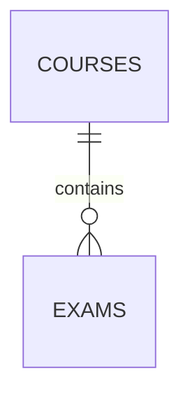

# SIM Platform — Exams Database Design

Status: Structural design approved; implementation details pending.

## 1. Scope and ownership

The Exams module owns the `exams` table. Courses owns `courses`; Schedule Builder owns confirmed student schedules and course selections. Exams does not store student exam attempts, grades, or enrollment records. Notifications and Audit Log own their respective records.

## 2. Database standards

MySQL InnoDB, utf8mb4, utf8mb4_unicode_ci. Laravel migrations with matching unsigned BIGINT primary and foreign keys. Audit timestamps use DATETIME in UTC; display uses Africa/Cairo. The exam date and time fields represent the scheduled academic date and time; their exact timezone conversion convention must be finalized consistently before implementation.

## 3. Table: exams

| Column | Type | Constraints |
|---|---|---|
| id | BIGINT UNSIGNED | PRIMARY KEY, AUTO_INCREMENT |
| course_id | BIGINT UNSIGNED | NOT NULL, FOREIGN KEY |
| type | ENUM('quiz','midterm','final','practical_or_oral') | NOT NULL |
| date | DATE | NOT NULL |
| start_time | TIME | NOT NULL |
| end_time | TIME | NOT NULL |
| location | VARCHAR(255) | NOT NULL |
| topics | JSON | NOT NULL |
| created_at | DATETIME | NOT NULL |
| updated_at | DATETIME | NOT NULL |

No additional defaults or uniqueness constraints are approved. Multiple exams of the same type may belong to one course.

### Topics

Store a nonempty JSON array of topic strings, for example:

```json
["Image Compression", "Digital Audio"]
```

Laravel validates that each element is a nonempty string. The frontend renders the array as a list.

## 4. Relationships and referential integrity

`exams.course_id` references `courses.id` with ON DELETE RESTRICT and ON UPDATE RESTRICT. Each exam belongs to exactly one course; a course may have zero or more exams. There is no direct student-exam relationship.



## 5. CHECK constraints

```sql
CHECK (start_time < end_time)
```

```sql
CHECK (JSON_TYPE(topics) = 'ARRAY' AND JSON_LENGTH(topics) > 0)
```

The first constraint requires exams to start and end on the same date with positive duration. The second enforces a nonempty JSON array. String-element validation remains in Laravel.

## 6. Indexes

| Index | Purpose |
|---|---|
| PRIMARY KEY (id) | Identify exams |
| INDEX (course_id, date, start_time) | Course exams and conflict checks |
| INDEX (date, start_time) | Chronological ordering and cross-course conflict candidates |
| INDEX (type, date, start_time) | Filter by type and order chronologically |

No separate course_id or date index is required because the composite indexes have these leading columns.

## 7. Conflict validation

On creation and changes to the course or exam timing, find existing exams on the same date satisfying:

```sql
existing.start_time < proposed.end_time
AND existing.end_time > proposed.start_time
```

Reject overlaps for the same course. For different courses, reject an overlap if at least one student has both courses in their confirmed schedule. Exclude the exam being edited. Adjacent time ranges do not overlap. Weekly lectures and sections are not checked.

Perform validation and persistence within a database transaction with appropriate locking to prevent concurrent administrative writes from bypassing validation. Reject the entire operation on conflict and preserve previous values. The exact locking strategy is pending; it must protect against concurrent inserts even when no matching exam row exists. Coordination with concurrent schedule changes also needs implementation review.

## 8. Access and lifecycle

Students may access exams only for courses in their confirmed schedules, including direct API requests. Expired exams are hidden from students but retained for administrators until term reset. Administrators may edit expired exams. Hard deletion removes an exam permanently. Term reset removes exam data. Audit records remain independent of deleted exams.

## 9. Module integration

- Courses: course identity and information.
- Schedule Builder: confirmed course selections and shared-student conflict checks.
- Identity & Access: authorization for Student, Admin and Owner.
- Notifications: creation, update and deletion/cancellation events for affected students.
- Audit Log: administrative create, update and delete operations, actor, exam identifier, timestamp, previous/new values and deletion snapshots.

## 10. Pending implementation details

- Exact concurrency-safe locking and coordination with schedule updates.
- Consistent timezone convention for separate exam date/time fields.
- Notification delivery and audit retention follow their owning modules.
- Exact expiry boundary and notification recipients when an exam changes course require implementation clarification.

No additional tables or functional requirements are approved by this document.
