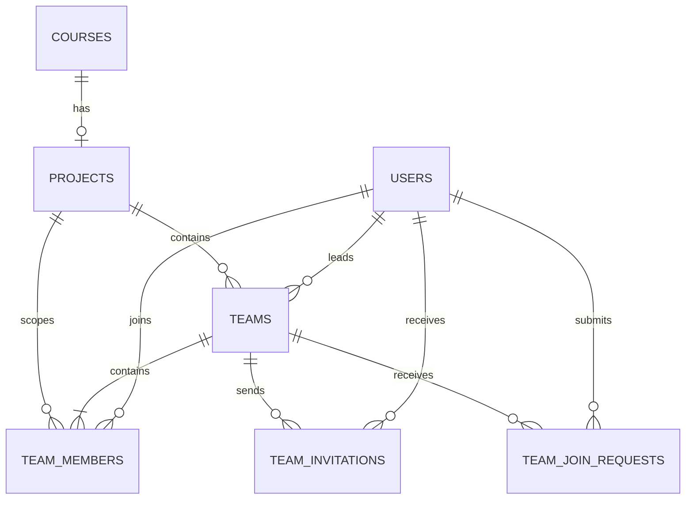

# SIM Platform — Projects & Teams Database Design

Status: Approved structural design; implementation details pending

## 1. Scope and standards

The module owns projects, teams, memberships, pending invitations and pending join requests. Projects exist solely to organize teams, not to manage submissions, grades or deadlines. MySQL InnoDB, utf8mb4_unicode_ci, Laravel migrations, UTC DATETIME timestamps, BIGINT UNSIGNED auto-increment primary keys. All foreign keys use ON UPDATE RESTRICT.

## 2. Tables

### projects

| Column | Type | Constraints |
|---|---|---|
| id | BIGINT UNSIGNED | PK, AUTO_INCREMENT |
| course_id | BIGINT UNSIGNED | NOT NULL, UNIQUE, FK courses.id |
| created_at | DATETIME | NOT NULL |
| updated_at | DATETIME | NOT NULL |

### teams

| Column | Type | Constraints |
|---|---|---|
| id | BIGINT UNSIGNED | PK, AUTO_INCREMENT |
| project_id | BIGINT UNSIGNED | NOT NULL, FK projects.id |
| leader_id | BIGINT UNSIGNED | NOT NULL, FK users.id |
| max_members | SMALLINT UNSIGNED | NOT NULL, CHECK >= 1 |
| created_at | DATETIME | NOT NULL |
| updated_at | DATETIME | NOT NULL |

Team display name is derived from the current leader's name. Capacity includes the leader and is immutable after creation. A capacity of one is allowed.

### team_members

| Column | Type | Constraints |
|---|---|---|
| id | BIGINT UNSIGNED | PK, AUTO_INCREMENT |
| project_id | BIGINT UNSIGNED | NOT NULL, FK projects.id |
| team_id | BIGINT UNSIGNED | NOT NULL, FK teams.id |
| user_id | BIGINT UNSIGNED | NOT NULL, FK users.id |
| created_at | DATETIME | NOT NULL |
| updated_at | DATETIME | NOT NULL |

UNIQUE (project_id, user_id). The leader is also a membership record. The redundant project identifier enables database-level uniqueness across teams in a project.

### team_invitations

| Column | Type | Constraints |
|---|---|---|
| id | BIGINT UNSIGNED | PK, AUTO_INCREMENT |
| team_id | BIGINT UNSIGNED | NOT NULL, FK teams.id |
| user_id | BIGINT UNSIGNED | NOT NULL, FK users.id |
| created_at | DATETIME | NOT NULL |

UNIQUE (team_id, user_id). Only pending invitations are stored. No status, sender identifier or updated_at.

### team_join_requests

| Column | Type | Constraints |
|---|---|---|
| id | BIGINT UNSIGNED | PK, AUTO_INCREMENT |
| team_id | BIGINT UNSIGNED | NOT NULL, FK teams.id |
| user_id | BIGINT UNSIGNED | NOT NULL, FK users.id |
| created_at | DATETIME | NOT NULL |

UNIQUE (team_id, user_id). Only pending requests are stored. No status, leader identifier or updated_at.

## 3. Relationships and deletion policies

| Child | Foreign key | Parent | ON DELETE |
|---|---|---|---|
| projects | course_id | courses.id | RESTRICT |
| teams | project_id | projects.id | CASCADE |
| teams | leader_id | users.id | RESTRICT |
| team_members | project_id | projects.id | RESTRICT |
| team_members | team_id | teams.id | CASCADE |
| team_members | user_id | users.id | RESTRICT |
| team_invitations | team_id | teams.id | CASCADE |
| team_invitations | user_id | users.id | RESTRICT |
| team_join_requests | team_id | teams.id | CASCADE |
| team_join_requests | user_id | users.id | RESTRICT |

Courses have zero or one project. All other listed relationships are one-to-many from parent to child.

Approved additional composite foreign key: team_members (team_id, project_id) references teams (id, project_id), with ON DELETE CASCADE and ON UPDATE RESTRICT. The supporting unique parent key and child index below are implementation necessities for this approved constraint. The standalone team_id FK is redundant if the composite FK replaces it; confirm migration representation before implementation.

## 4. Indexes

| Table | Approved indexes |
|---|---|
| projects | PK(id), UNIQUE(course_id) |
| teams | PK(id), INDEX(project_id), INDEX(leader_id) |
| team_members | PK(id), UNIQUE(project_id,user_id), INDEX(team_id), INDEX(user_id) |
| team_invitations | PK(id), UNIQUE(team_id,user_id), INDEX(user_id) |
| team_join_requests | PK(id), UNIQUE(team_id,user_id), INDEX(user_id) |

Composite FK support: UNIQUE teams(id,project_id), INDEX team_members(team_id,project_id). The latter can replace the standalone team_id index because it has the same leading column. These supporting keys are derived from the approved composite relationship, not additional product requirements.

## 5. ERD

## 6. Integrity and transactions

- Create team and creator membership atomically. Verify confirmed course access and no existing membership in the project.
- Only the current leader may accept/reject join requests, invite students, remove other members or delete the team. The invited student accepts/rejects their own invitation.
- Accepting a pending invitation or request must atomically validate authorization, course access, membership uniqueness and available capacity, insert membership and delete the accepted pending record.
- Lock the team during capacity-sensitive operations; the unique project/user constraint also protects concurrent joins across teams. Exact lock ordering and retry strategy remain implementation decisions.
- Rejecting an invitation or request deletes its record. Other pending invitations remain after joining; acceptance is blocked while the student belongs to a team in the project.
- Leader must always be a member of the same team. Enforce this in Laravel transactions; no circular foreign key is proposed.
- When the leader leaves, select the oldest remaining member by created_at then id. If no member remains, delete the team. Invitations and requests stay attached to a surviving team and become manageable by its new leader.
- Admin/Owner may change the leader to an existing team member, but cannot manage membership or accept/reject requests on behalf of the leader.
- Remove membership when the student's confirmed schedule no longer includes the project course. Apply leader replacement or empty-team deletion as needed.
- Account deletion: remove the user's invitations, requests and memberships and replace leadership or delete empty teams before deleting the user, within the platform account-deletion transaction.
- Project deletion: explicitly clean membership records before deleting the project because project_id on team_members is RESTRICT; team deletion cascades pending records and remaining memberships. Use one transaction.
- Term reset removes all five tables' term records in dependency-safe order; accounts remain.

## 7. Module integration

Courses supplies course identity; Schedule Builder supplies confirmed selections; Identity & Access supplies users and roles. Notifications handles project updates and approved team events. No Projects & Teams audit requirement has been approved.

## 8. Remaining implementation decisions

Invitation/request expiry and cancellation, treatment of other pending join requests after acceptance, exact lock order, deadlock retries, notification dispatch after commit, and migration representation of the composite FK remain to be finalized. The PRD does not specify these policies. No historical invitation/request storage is required under the approved pending-only design.
