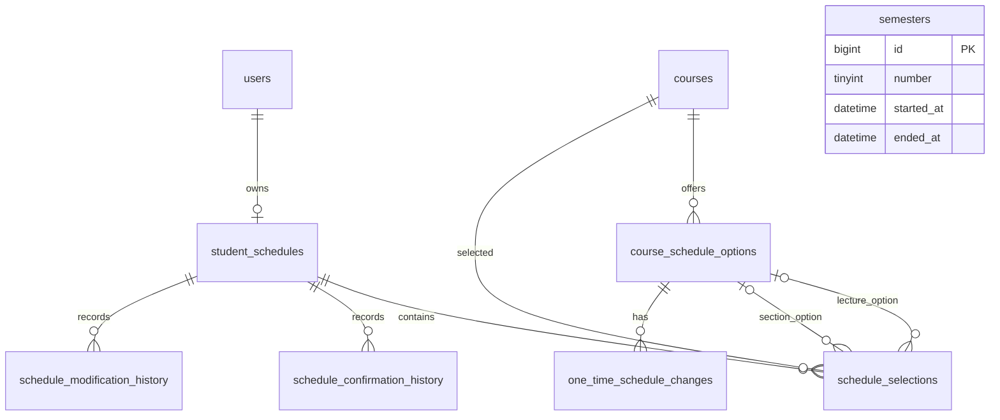

# SIM Platform – Schedule Builder Database Design

**Status:** Reviewed design – approved decisions consolidated  
**Architecture:** Modular Monolith  
**Backend:** Laravel  
**Database:** MySQL / InnoDB

## 1. Scope and ownership

Schedule Builder (User Schedule) owns student schedules, selections and confirmation/modification history. Courses owns regular schedule options and one-time schedule changes. The semester table supports the Owner-controlled term lifecycle; its module ownership is not explicitly finalized in the available decisions.

Modules use service interfaces and domain events rather than directly accessing another module's internal tables. All seven tables reside in the same database.

## 2. Database standards

- All primary keys are `BIGINT UNSIGNED AUTO_INCREMENT`.
- Foreign keys use `BIGINT UNSIGNED` and `ON UPDATE RESTRICT`.
- Table and column names use plural snake_case and snake_case respectively.
- Character set: `utf8mb4`; collation: `utf8mb4_unicode_ci`.
- DATETIME values are stored in UTC and displayed in Africa/Cairo. Weekly TIME values represent local academic timetable times; occurrence dates represent local calendar dates.
- Use Laravel migrations, validation and transactions. Use NOT NULL unless absence is meaningful.
- Ensure supporting foreign-key indexes exist without duplicating indexes already covering the same leading columns.

## 3. Table definitions

### 3.1 `semesters`

| Column | Data type | Constraints |
|---|---|---|
| id | BIGINT UNSIGNED | PK, AUTO_INCREMENT |
| number | TINYINT UNSIGNED | NOT NULL |
| started_at | DATETIME | NOT NULL |
| ended_at | DATETIME | NULL |
| created_at | DATETIME | NOT NULL |
| updated_at | DATETIME | NOT NULL |

**Constraints and indexes**

- PRIMARY KEY (id)
- CHECK (number IN (1, 2))
- CHECK (ended_at IS NULL OR ended_at > started_at)

**Rules**

- Two terms only; no summer term.
- Owner manually starts and ends terms; dates are not predetermined.
- `ended_at IS NULL` identifies an active term.
- Laravel must enforce at most one active term using concurrency-safe transaction handling. The exact locking mechanism is not finalized.
- Operational tables do not contain `semester_id` because only current-term operational data is retained.

### 3.2 `course_schedule_options`

**Owner:** Courses

| Column | Data type | Constraints |
|---|---|---|
| id | BIGINT UNSIGNED | PK, AUTO_INCREMENT |
| course_id | BIGINT UNSIGNED | FK, NOT NULL |
| type | ENUM('lecture','section') | NOT NULL |
| day | ENUM('saturday','sunday','monday','tuesday','wednesday','thursday') | NOT NULL |
| start_time | TIME | NOT NULL |
| end_time | TIME | NOT NULL |
| location | VARCHAR(255) | NOT NULL |
| created_at | DATETIME | NOT NULL |
| updated_at | DATETIME | NOT NULL |

**Constraints and indexes**

- PRIMARY KEY (id)
- FK (course_id) REFERENCES courses(id) ON DELETE RESTRICT ON UPDATE RESTRICT
- CHECK (start_time < end_time)
- Supporting index on course_id.

**Rules**

- A course can have multiple lecture and section options.
- Friday is excluded from regular weekly options.
- No capacity limit is defined for options.
- Options are distinct from educational lectures and sections; educational files are shared across the course's options.

### 3.3 `student_schedules`

**Owner:** User Schedule

| Column | Data type | Constraints |
|---|---|---|
| id | BIGINT UNSIGNED | PK, AUTO_INCREMENT |
| user_id | BIGINT UNSIGNED | FK, NOT NULL, UNIQUE |
| status | ENUM('complete','incomplete') | NOT NULL |
| created_at | DATETIME | NOT NULL |
| updated_at | DATETIME | NOT NULL |

**Constraints and indexes**

- PRIMARY KEY (id)
- UNIQUE (user_id)
- INDEX (status)
- FK (user_id) REFERENCES users(id) ON DELETE RESTRICT ON UPDATE RESTRICT

**Rules**

- Each student has zero or one persisted schedule.
- No draft schedule is persisted before successful confirmation.
- Total credit hours are calculated from selected courses, not stored in this table.
- Administrative invalidation may change a previously confirmed schedule to incomplete.

### 3.4 `schedule_selections`

**Owner:** User Schedule

| Column | Data type | Constraints |
|---|---|---|
| id | BIGINT UNSIGNED | PK, AUTO_INCREMENT |
| schedule_id | BIGINT UNSIGNED | FK, NOT NULL |
| course_id | BIGINT UNSIGNED | FK, NOT NULL |
| lecture_option_id | BIGINT UNSIGNED | FK, NULL |
| section_option_id | BIGINT UNSIGNED | FK, NULL |
| created_at | DATETIME | NOT NULL |
| updated_at | DATETIME | NOT NULL |

**Constraints and indexes**

- PRIMARY KEY (id)
- UNIQUE (schedule_id, course_id)
- FK (schedule_id) REFERENCES student_schedules(id) ON DELETE CASCADE
- FK (course_id) REFERENCES courses(id) ON DELETE RESTRICT
- FK (lecture_option_id) REFERENCES course_schedule_options(id) ON DELETE SET NULL
- FK (section_option_id) REFERENCES course_schedule_options(id) ON DELETE SET NULL
- All foreign keys use ON UPDATE RESTRICT.
- Supporting indexes on course_id, lecture_option_id and section_option_id; the composite UNIQUE covers schedule_id.

**Rules**

- One selection row per course per schedule.
- Laravel validates that both selected options belong to the selected course and have the correct type.
- Both options must be present for successful confirmation.
- Nullable option references allow administrative invalidation without removing the selected course.

### 3.5 `one_time_schedule_changes`

**Owner:** Courses

| Column | Data type | Constraints |
|---|---|---|
| id | BIGINT UNSIGNED | PK, AUTO_INCREMENT |
| schedule_option_id | BIGINT UNSIGNED | FK, NOT NULL |
| type | ENUM('cancelled','rescheduled','location_changed') | NOT NULL |
| original_date | DATE | NOT NULL |
| original_location | VARCHAR(255) | NOT NULL |
| new_date | DATE | NULL |
| new_start_time | TIME | NULL |
| new_end_time | TIME | NULL |
| new_location | VARCHAR(255) | NULL |
| revoked_at | DATETIME | NULL, DEFAULT NULL |
| created_at | DATETIME | NOT NULL |
| updated_at | DATETIME | NOT NULL |

**Constraints and indexes**

- PRIMARY KEY (id)
- INDEX (schedule_option_id, original_date)
- FK (schedule_option_id) REFERENCES course_schedule_options(id) ON DELETE CASCADE ON UPDATE RESTRICT
- Type-specific CHECK constraint, expressed below.

```sql
CHECK (
    (type = 'cancelled' AND new_date IS NULL
     AND new_start_time IS NULL AND new_end_time IS NULL
     AND new_location IS NULL)
 OR (type = 'rescheduled' AND new_date IS NOT NULL
     AND new_start_time IS NOT NULL AND new_end_time IS NOT NULL
     AND new_location IS NULL)
 OR (type = 'location_changed' AND new_date IS NULL
     AND new_start_time IS NULL AND new_end_time IS NULL
     AND new_location IS NOT NULL)
)
CHECK (new_start_time IS NULL OR new_end_time IS NULL
       OR new_start_time < new_end_time)
```

**Rules**

- An exception affects a specific occurrence, not the recurring weekly option.
- original_location preserves the location at the time the exception is created.
- `revoked_at IS NULL` means the exception is active; a non-null value records when the exception was revoked.
- Revoking an exception restores the regular occurrence, sends a notification and retains the exception record while its parent option exists.
- Cancelling an occurrence (`type = 'cancelled'`) differs from revoking an exception.
- Rescheduling conflicts trigger notifications only; they do not automatically alter student selections.
- Administrative actor information belongs to Audit Log, not a created_by column here.
- Students see relevant current/upcoming exceptions; historical records remain internal until reset, subject to parent deletion.

### 3.6 `schedule_confirmation_history`

**Owner:** User Schedule

| Column | Data type | Constraints |
|---|---|---|
| id | BIGINT UNSIGNED | PK, AUTO_INCREMENT |
| schedule_id | BIGINT UNSIGNED | FK, NOT NULL |
| confirmed_at | DATETIME | NOT NULL |

- PRIMARY KEY (id)
- INDEX (schedule_id, confirmed_at)
- FK (schedule_id) REFERENCES student_schedules(id) ON DELETE CASCADE ON UPDATE RESTRICT
- Record each successful initial confirmation and reconfirmation.
- Immutable timestamp-only history; no schedule snapshot or updated_at.

### 3.7 `schedule_modification_history`

**Owner:** User Schedule

| Column | Data type | Constraints |
|---|---|---|
| id | BIGINT UNSIGNED | PK, AUTO_INCREMENT |
| schedule_id | BIGINT UNSIGNED | FK, NOT NULL |
| action | ENUM('course_added','course_removed','lecture_changed','section_changed','option_invalidated') | NOT NULL |
| source | ENUM('student','admin') | NOT NULL |
| changes | JSON | NOT NULL |
| created_at | DATETIME | NOT NULL |

- PRIMARY KEY (id)
- INDEX (schedule_id, created_at)
- FK (schedule_id) REFERENCES student_schedules(id) ON DELETE CASCADE ON UPDATE RESTRICT
- changes stores before/after information for the modification.
- source = admin includes Owner operations.
- Record persisted modifications, including administrative option invalidation; do not record unconfirmed edits as committed changes.
- Immutable; no updated_at.

## 4. Relationships and ERD



The semesters table has no direct FK relationship to operational tables. users and courses are existing external-module tables, not additional tables created by this design.

## 5. Business rules and persistence

- Students manually select courses they registered for at college; no university database integration.
- Students may select courses across academic levels. Prerequisites are informational only.
- Credit hours are integers; zero-credit courses are allowed.
- Minimum confirmed total: 13; maximum: 21. Adding courses cannot exceed 21; dropping courses must respect the minimum rule.
- One lecture option and one section option per selected course are required.
- Prevent overlaps between any selected weekly lecture/section intervals on the same day. Adjacent intervals do not overlap.
- First confirmation persists the schedule and selections. Later edits are persisted only after successful reconfirmation; the previously persisted schedule remains in effect until then, except for administrative invalidation.
- Validate current options, credit hours and conflicts on the backend before committing.
- Confirmation and its associated history writes must be atomic.
- Exams and quizzes are displayed separately in Exams, not in the weekly schedule.
- Admin and Owner may view student schedules and search by name or Student ID, but cannot directly edit a student's choices.

## 6. Administrative changes

- When a regular option is deleted, its selection references become NULL, affected schedules become incomplete and affected students receive notifications.
- When a regular option is edited, revalidate affected schedules. If conflicts arise, invalidate affected selections and mark those schedules incomplete; otherwise retain selections.
- Students must choose replacements and reconfirm incomplete schedules.
- A credit-hour change that puts a schedule outside 13–21 hours makes it incomplete and triggers notification.
- Creating, editing or revoking a one-time exception notifies affected students. The recurring option remains unchanged.
- Coordinate changes to options, selections, status and history through owning-module services and transactions; do not rely on SET NULL alone to implement business rules.

## 7. Integration

| Module | Responsibility |
|---|---|
| Identity & Access | Owns users; provides identity and account status; coordinates account deletion. |
| Courses | Owns course definitions, regular options and exceptions; publishes relevant changes. |
| User Schedule | Owns confirmed selections, validation, schedule status and histories. |
| Assignments / Exams / Projects & Teams | Obtain confirmed course selections through User Schedule interfaces. |
| Notifications | Receives relevant events and manages recipients and delivery. |
| Audit Log | Records applicable administrative operations independently of schedule histories. |
| Admin Dashboard | Presentation/query layer only; owns no schedule data. |

## 8. Deletion and term reset

- Account deletion: Identity & Access calls User Schedule to remove the student's schedule within the coordinated database transaction. Selections and both history tables cascade from the schedule. The user FK restricts deletion until cleanup succeeds.
- At term end, Owner initiates coordinated deletion of term-specific data. Delete student schedules (and dependent selections/histories), one-time changes and regular options, along with operational data owned by other modules.
- Students must rebuild schedules in the new term.
- No old schedule versions or term-specific operational history are archived by this design.
- Existing account data remains. Stable course definitions are retained under the earlier Courses design; the later broad reset wording requires reconciliation before implementation (see section 9).
- Physical file cleanup is performed by the owning module after successful database commit where applicable.

## 9. Review items and limits of approval

The seven table structures above consolidate the approved design. The following are explicitly not new approved decisions:

- The exact semester lifecycle module owner and retention of ended semester records require confirmation.
- The earlier architecture retains stable course definitions and Audit Log records across terms, whereas later discussion described deleting everything except users. Confirm the precise reset boundary before implementing destructive operations; preserve referenced identity lookup records unless explicitly revised.
- ON DELETE CASCADE on one_time_schedule_changes removes exception history if its parent option is deleted before term end. Revocation alone preserves the record. Full history retention after parent deletion is not guaranteed by the approved schema.
- No uniqueness constraint for simultaneous active exceptions on the same occurrence has been approved; the handling of multiple active exceptions remains unspecified.
- The exact concurrency/locking strategy, event delivery implementation and JSON history payload schema remain implementation decisions.
- Supporting FK indexes are documented as required by InnoDB, not as newly approved performance indexes.
- Weekly local TIME and occurrence DATE interpretation is documented to distinguish them from UTC DATETIME storage; confirm this convention during implementation if needed.

**End of document**
